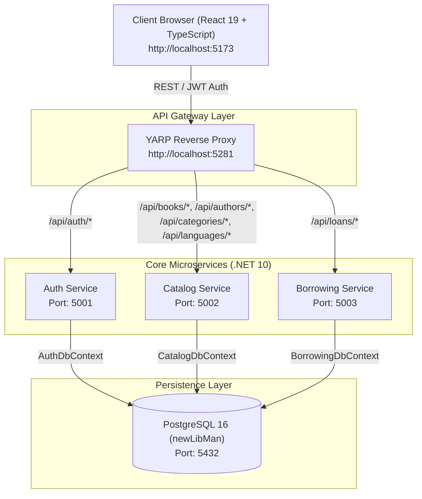
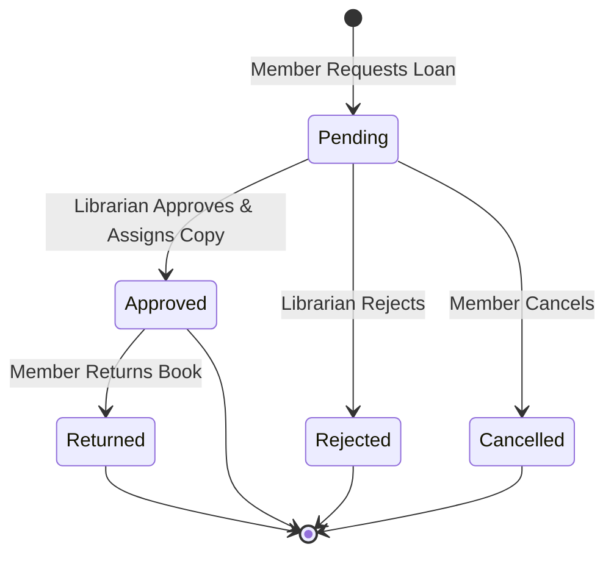

# 📚 Library Management System

A modern, cloud-ready, enterprise-grade **Microservices-based Library Management Platform** built with **ASP.NET Core (.NET 10)**, **React 19**, **TypeScript**, **PostgreSQL**, **YARP (Yet Another Reverse Proxy)**, and **Docker / Kubernetes**.

---

## 📑 Table of Contents

- [Overview](#-overview)
- [System Architecture](#-system-architecture)
- [Microservices Breakdown](#-microservices-breakdown)
- [Key Features](#-key-features)
- [Pre-Configured Demo Accounts](#-pre-configured-demo-accounts)
- [Technology Stack](#-technology-stack)
- [Project Directory Structure](#-project-directory-structure)
- [API Endpoints Reference](#-api-endpoints-reference)
- [Getting Started](#-getting-started)
  - [Prerequisites](#prerequisites)
  - [Option 1: Quick Start Script (Windows)](#option-1-quick-start-script-windows)
  - [Option 2: Docker Compose](#option-2-docker-compose)
  - [Option 3: Manual Execution (Local Dev)](#option-3-manual-execution-local-dev)
- [Kubernetes Deployment](#-kubernetes-deployment)
- [Environment Configuration](#-environment-configuration)
- [Advanced Architecture Details](#-advanced-architecture-details)

---

## 🌟 Overview

The **Library Management System** is designed with a decoupled microservice architecture ensuring high cohesion, clear domain boundaries, and independent scalability. The system streamlines all essential library workflows: user registration and role-based authentication, book cataloguing and copy inventory tracking, optimistic concurrency control via HTTP ETags, and end-to-end borrowing lifecycles with librarian review.

---

## 🏗️ System Architecture



---

## 🧩 Microservices Breakdown

| Service | Port | Description | Database Context | Swagger Docs |
|---|---|---|---|---|
| **API Gateway** | `5281` | Central entry point running **YARP**, route rewriting, unified CORS policy (`5173`), and request logging. | N/A | `http://localhost:5281/` *(Health)* |
| **Auth Service** | `5001` | User registration, authentication, JWT token generation, password hashing via BCrypt, and role validation. | `AuthDbContext` | `http://localhost:5001/swagger` |
| **Catalog Service** | `5002` | Books, authors, categories, languages, and physical book copy management. Includes optimistic concurrency (ETags). | `CatalogDbContext` | `http://localhost:5002/swagger` |
| **Borrowing Service** | `5003` | Loan lifecycle management (requests, reviews, approvals, returns, cancellations) and inventory status sync. | `BorrowingDbContext` | `http://localhost:5003/swagger` |
| **Frontend Web UI** | `5173` | React 19 single-page application built with Vite, Tailwind CSS v4, Lucide icons, Framer Motion, and TanStack Query. | Client Cache | `http://localhost:5173` |

---

## ✨ Key Features

### 1. 🔐 Role-Based Access Control (RBAC)
- **Three user tiers**: `Admin`, `Librarian`, and `Member`.
- Secure JWT authentication with claims-based authorization on both backend controllers and frontend route guards.
- Password hashing with industry-standard **BCrypt**.

### 2. 📖 Catalog & Physical Inventory Management
- Full catalog operations for books, authors, genres/categories, and languages.
- Individual **Book Copy tracking** with distinct statuses (`Available`, `OnLoan`, `Lost`, `Damaged`, `Maintenance`).
- Dynamic search, filters by title/author/ISBN/category, and pagination support.

### 3. ⚡ Optimistic Concurrency Control (ETags)
- Protection against lost updates when multiple staff members edit book records simultaneously.
- Uses PostgreSQL concurrency tokens with HTTP `ETag` and `If-Match` headers.
- Automatically handles `428 Precondition Required` and `412 Precondition Failed` responses.

### 4. 🔄 Loan Lifecycle State Machine

- Real-time loan status tracking with requested periods (1–60 days).
- Automated overdue checks and synchronized copy status updates.

### 5. 🎨 Modern Reactive UI
- **TanStack Query (React Query v5)** for client-side caching, background refetching, and optimistic mutations.
- **Tailwind CSS v4** styling with responsive dashboards.
- **Framer Motion** transitions and **Lucide React** iconography.

---

## 👥 Pre-Configured Demo Accounts

Each service automatically executes EF Core migrations and seeds initial accounts upon startup:

| Role | Email Address | Password | Permissions |
|---|---|---|---|
| **Admin** | `admin@library.com` | `Admin@123` | Full system access: add/edit books, manage copies, manage loans, view all records. |
| **Librarian** | `librarian@library.com` | `Librarian@123` | Add/edit books, assign copies, approve/reject/return book loans. |
| **Member** | `member@library.com` | `Member@123` | Browse catalog, view authors, request loans, view and cancel own loans. |

---

## 🛠️ Technology Stack

### Backend
- **Framework**: [.NET 10 (C# 13)](https://dotnet.microsoft.com/)
- **API Gateway**: [YARP (Yet Another Reverse Proxy) v2.3](https://microsoft.github.io/reverse-proxy/)
- **ORM & Database**: [Entity Framework Core 10](https://learn.microsoft.com/ef/core/) with [Npgsql PostgreSQL](https://www.npgsql.org/)
- **Validation**: [FluentValidation 12](https://fluentvalidation.net/)
- **Security & Tokens**: `Microsoft.AspNetCore.Authentication.JwtBearer` & `BCrypt.Net-Next`
- **Logging**: [Serilog](https://serilog.net/) with Console & Daily Rolling File sinks
- **API Documentation**: [Swagger / Swashbuckle](https://github.com/domaindrivendev/Swashbuckle.AspNetCore)

### Frontend
- **Framework**: [React 19](https://react.dev/) + [Vite 8](https://vitejs.dev/)
- **Language**: [TypeScript](https://www.typescriptlang.org/)
- **Styling**: [Tailwind CSS v4](https://tailwindcss.com/)
- **State & Server Cache**: [TanStack Query v5](https://tanstack.com/query/latest)
- **Routing**: [React Router v7](https://reactrouter.com/)
- **HTTP Client**: [Axios](https://axios-http.com/) with centralized interceptors
- **Icons & Motion**: [Lucide React](https://lucide.dev/) & [Framer Motion](https://www.framer.com/motion/)

### DevOps & Orchestration
- **Containers**: Docker & Multi-stage Dockerfiles
- **Orchestration**: Docker Compose v3.8 & Kubernetes (k8s manifests)
- **Database Engine**: PostgreSQL 16 Alpine

---

## 📁 Project Directory Structure

```text
LibraryManagementSystem/
├── .vscode/                      # Editor configuration
├── frontend/                     # React 19 + TypeScript SPA
│   ├── public/                   # Static assets
│   ├── src/
│   │   ├── app/                  # Application root & React Router definitions
│   │   ├── feature/
│   │   │   ├── auth/             # Login, register, auth context & guards
│   │   │   ├── author/           # Authors list & author details
│   │   │   ├── borrowing/        # My loans & librarian loan management
│   │   │   └── catalog/          # Books catalog, add/edit books, copies management
│   │   ├── pages/                # Landing, Home & About pages
│   │   └── shared/               # Shared components, hooks, Axios client
│   ├── package.json
│   └── vite.config.ts
├── k8s/                          # Kubernetes Deployment & Service Manifests
│   ├── api-gateway.yaml          # Gateway deployment & LoadBalancer service
│   ├── auth-service.yaml         # Auth service deployment & service
│   ├── borrowing-service.yaml    # Borrowing service deployment & service
│   ├── catalog-service.yaml      # Catalog service deployment & service
│   ├── config.yaml               # Shared ConfigMap & Secret
│   └── postgres.yaml             # PostgreSQL PVC, Deployment & Service
├── services/                     # .NET 10 Microservices
│   ├── AuthService/              # Port 5001 - Identity & Auth domain
│   ├── BorrowingService/         # Port 5003 - Loans & Borrowing domain
│   ├── CatalogService/           # Port 5002 - Books & Authors domain
│   ├── Gateway/                  # Port 5281 - YARP Reverse Proxy
│   └── Shared/                   # Common DTOs, JWT extensions & Swagger setups
├── docker-compose.yml            # Multi-container local orchestration
├── LibraryManagement.slnx        # Visual Studio XML Solution definition
├── start-services.bat            # Windows 1-click startup batch script
└── README.md                     # Root project documentation
```

---

## 📡 API Endpoints Reference

All client calls route through the **API Gateway** (`http://localhost:5281`):

### 🔑 Authentication Service (`/api/auth`)
| Method | Endpoint | Authorization | Description |
|---|---|---|---|
| `POST` | `/api/auth/register` | Public | Register a new user account |
| `POST` | `/api/auth/login` | Public | Authenticate user and receive JWT bearer token |

### 📚 Catalog Service (`/api/books`, `/api/authors`, etc.)
| Method | Endpoint | Authorization | Description |
|---|---|---|---|
| `GET` | `/api/books` | Public | Search books (paginated, filtered by keyword/category/author) |
| `GET` | `/api/books/{id}` | Authenticated | Get book details (returns `ETag` header) |
| `POST` | `/api/books` | Librarian, Admin | Create a new book |
| `PATCH` | `/api/books/{id}` | Librarian, Admin | Update book metadata (requires `If-Match` header) |
| `DELETE`| `/api/books/{id}` | Librarian, Admin | Soft delete a book |
| `GET` | `/api/books/{id}/copies` | Librarian, Admin | View all physical copies of a book |
| `POST` | `/api/books/{id}/copies` | Librarian, Admin | Add new physical copies for a book |
| `PATCH` | `/api/books/{id}/copies/{copyId}/status` | Librarian, Admin | Update copy condition/status |
| `DELETE`| `/api/books/{id}/copies/{copyId}` | Librarian, Admin | Remove a specific copy |
| `GET` | `/api/authors` | Public | Search and list authors |
| `GET` | `/api/authors/{id}` | Public | Get author profile |
| `GET` | `/api/authors/{id}/books` | Public | Get books written by specific author |
| `GET` | `/api/categories` | Public | List book categories/genres |
| `GET` | `/api/languages` | Public | List available languages |

### 🤝 Borrowing Service (`/api/loans`)
| Method | Endpoint | Authorization | Description |
|---|---|---|---|
| `POST` | `/api/loans` | Member, Librarian, Admin | Submit a borrowing request for a book |
| `GET` | `/api/loans/my-loans` | Authenticated | View current logged-in member's loans |
| `GET` | `/api/loans` | Librarian, Admin | View all system loans (filterable by status) |
| `GET` | `/api/loans/{id}` | Authenticated | View loan details |
| `DELETE`| `/api/loans/{id}/cancel` | Member | Cancel a pending loan request |
| `PUT` | `/api/loans/{id}/approve` | Librarian, Admin | Approve loan and assign physical copy |
| `PUT` | `/api/loans/{id}/reject` | Librarian, Admin | Reject loan request with optional remarks |
| `PUT` | `/api/loans/{id}/return` | Librarian, Admin | Mark book as returned and release copy |

---

## 🚀 Getting Started

### Prerequisites

Ensure the following tools are installed:
- [.NET 10.0 SDK](https://dotnet.microsoft.com/download)
- [Node.js (v18+)](https://nodejs.org/) & `npm`
- [Docker Desktop](https://www.docker.com/products/docker-desktop/) *(for Docker or Kubernetes)*
- [PostgreSQL 16](https://www.postgresql.org/) *(only if running without Docker)*

---

### Option 1: Quick Start Script (Windows)

If you already have PostgreSQL running locally (or via Docker on port `5432`):

1. **Start PostgreSQL**:
   ```bash
   docker run --name library-postgres -e POSTGRES_USER=postgres -e POSTGRES_PASSWORD=password -e POSTGRES_DB=newLibMan -p 5432:5432 -d postgres:16-alpine
   ```
2. **Launch all services and the frontend** with one click:
   ```cmd
   start-services.bat
   ```
This script launches individual command windows for:
- Auth Service (`http://localhost:5001`)
- Catalog Service (`http://localhost:5002`)
- Borrowing Service (`http://localhost:5003`)
- API Gateway (`http://localhost:5281`)
- Vite React Frontend (`http://localhost:5173`)

---

### Option 2: Docker Compose

To run the entire system including PostgreSQL, backend microservices, and gateway in Docker containers:

```bash
# Build and start all containers in detached mode
docker compose up --build -d

# Check service status
docker compose ps

# View rolling logs across all services
docker compose logs -f
```

Then start the frontend locally:
```bash
cd frontend
npm install
npm run dev
```

Visit `http://localhost:5173` in your browser.

To stop the containers:
```bash
docker compose down -v
```

---

### Option 3: Manual Execution (Local Dev)

#### 1. Setup Database
Ensure PostgreSQL is active on port `5432` with database `newLibMan`, username `postgres`, and password `password`.

#### 2. Start Microservices in Separate Terminals
```bash
# Terminal 1 - Auth Service
dotnet run --project services/AuthService/LibraryManagement.Services.Auth.csproj

# Terminal 2 - Catalog Service
dotnet run --project services/CatalogService/LibraryManagement.Services.Catalog.csproj

# Terminal 3 - Borrowing Service
dotnet run --project services/BorrowingService/LibraryManagement.Services.Borrowing.csproj

# Terminal 4 - API Gateway
dotnet run --project services/Gateway/LibraryManagement.Gateway.csproj
```

#### 3. Start Frontend
```bash
# Terminal 5 - Frontend
cd frontend
npm install
npm run dev
```

---

## ☸️ Kubernetes Deployment

The `k8s/` directory contains complete Kubernetes manifests for production-style deployment.

```bash
# 1. Apply configuration and secrets
kubectl apply -f k8s/config.yaml

# 2. Deploy PostgreSQL persistence & service
kubectl apply -f k8s/postgres.yaml

# 3. Deploy microservices
kubectl apply -f k8s/auth-service.yaml
kubectl apply -f k8s/catalog-service.yaml
kubectl apply -f k8s/borrowing-service.yaml

# 4. Deploy API Gateway
kubectl apply -f k8s/api-gateway.yaml

# 5. Verify deployment status
kubectl get pods
kubectl get services
```

---

## ⚙️ Environment Configuration

Default configuration keys used across services:

| Key | Description | Default Local Value |
|---|---|---|
| `ConnectionStrings__DefaultConnection` | PostgreSQL connection string | `Host=localhost;Port=5432;Database=newLibMan;Username=postgres;Password=password` |
| `Jwt__Key` | Secret key used to sign and verify JWT tokens | `tyytytfyufytftftf6556fytfycvycyt` |
| `Jwt__Issuer` | Valid token issuer | `LibraryManagement.API` |
| `Jwt__Audience` | Valid token audience | `LibraryManagement.Client` |
| `ReverseProxy__Clusters__*__Destinations` | YARP gateway cluster destination URLs | Handled dynamically in Docker/k8s/local configs |

---

## 🔬 Advanced Architecture Details

### Optimistic Concurrency Control (ETag Protocol)
To ensure data consistency during concurrent edits:
1. When fetching a book via `GET /api/books/{id}`, the API calculates a base64 ETag from the book's `Version` column (`xmin` row tracking) and includes it in the `ETag` HTTP response header.
2. When submitting updates via `PATCH /api/books/{id}`, the client must supply the `If-Match: "<ETag>"` header.
3. If another user modified the record between reading and writing, the service returns **`412 Precondition Failed`**, preventing inadvertent overwrites.

### Frontend Data Invalidation Flow
1. Mutations executed via React Query automatically invalidate related query keys (e.g., `["books"]`, `["loans", "my"]`, `["loans", "all"]`).
2. Axios response interceptors handle authentication failures and synchronize session state.
3. Protected routes verify user permissions prior to mounting page components.

---

## 📄 License
This project is open-source and available under the **MIT License**.
