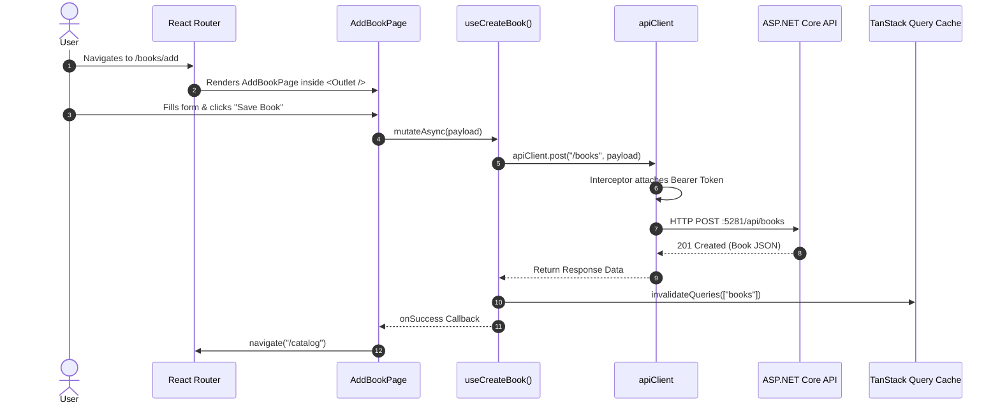

# Frontend Architecture & Data Flow Guide
**Library Management Application**

This guide provides a comprehensive, line-by-line walkthrough of how **Axios**, **TanStack Query (React Query)**, and **React Router** work together across this project.

---

## 1. High-Level Architecture Overview

```mermaid
flowchart TD
    subgraph Browser["User Browser"]
        URL["1. Route /catalog/:id"] --> Router["2. React Router (routes.tsx)"]
        Router --> Guard["3. ProtectedRoute"]
        Guard --> Page["4. BookDetailsPage"]
        Page --> Hook["5. useBook(id) (TanStack Query)"]
    end

    subgraph QueryLayer["TanStack Query Engine"]
        Hook --> Cache{"In Cache & Fresh?"}
        Cache -- Yes --> ReturnCache["Return Cached Data immediately"]
        Cache -- No --> Fetcher["Trigger queryFn: getBookById(id)"]
    end

    subgraph Network["Network & API Client"]
        Fetcher --> Axios["6. apiClient (Axios Instance)"]
        Axios --> Interceptor["7. Request Interceptor (Inject JWT)"]
        Interceptor --> HTTP["8. HTTP GET :5281/api/books/{id}"]
    end

    subgraph Backend["ASP.NET Core Web API"]
        HTTP --> Controller["BooksController"]
        Controller --> Service["BookService.cs"]
        Service --> DB[(Database)]
    end

    HTTP <-- JSON Response -- Controller
    Axios <-- Response Data -- HTTP
    Hook <-- Update Cache & State -- Axios
    Page <-- { data, isLoading, error } -- Hook
```

---

## 2. HTTP Layer: Axios

### 2.1 Centralized Axios Client (`frontend/src/shared/services/apiClient.ts`)

```typescript
import axios from "axios";

// 1. Create configured instance
const apiClient = axios.create({
  baseURL: "http://localhost:5281/api",
  headers: {
    "Content-Type": "application/json",
  },
});

// 2. Request Interceptor: Automatically attach JWT
apiClient.interceptors.request.use(
  (config) => {
    const token = localStorage.getItem("library_auth_token");

    if (token) {
      config.headers.Authorization = `Bearer ${token}`;
    }

    return config;
  },
  (error) => Promise.reject(error)
);

export default apiClient;
```

#### Line-by-Line Breakdown:
- **`axios.create({ baseURL, headers })`**:
  - `baseURL: "http://localhost:5281/api"`: Sets the base URL for the backend ASP.NET Core API. All API calls (e.g. `apiClient.get('/books')`) automatically resolve to `http://localhost:5281/api/books`.
  - `headers: { "Content-Type": "application/json" }`: Specifies the payload format expected by ASP.NET model binders.
- **`apiClient.interceptors.request.use(...)`**:
  - Acts as client-side HTTP middleware that intercepts every outgoing request before it leaves the browser.
  - `localStorage.getItem("library_auth_token")`: Reads the JWT generated upon login.
  - `config.headers.Authorization = `Bearer ${token}``: Appends the Bearer token so ASP.NET `[Authorize]` attributes validate the request.

---

### 2.2 Feature API Services (`frontend/src/feature/catalog/api/bookApi.ts`)

```typescript
import apiClient from "@/shared/services/apiClient";
import type {
  Book,
  BookDetails,
  BookSearchParams,
  PagedResult,
  CreateBookRequest,
  UpdateBookRequest,
  BookWithEtag,
} from "../types";

// GET with Query Parameters
export async function getBooks(
  params?: BookSearchParams
): Promise<PagedResult<Book>> {
  const response = await apiClient.get<PagedResult<Book>>("/books", {
    params,
  });
  return response.data;
}

// GET by ID with ETag extraction for Concurrency Control
export async function getBookByIdWithEtag(id: number): Promise<BookWithEtag> {
  const response = await apiClient.get<BookDetails>(`/books/${id}`);
  const rawEtag = response.headers["etag"] || response.headers["ETag"] || "";
  return {
    book: response.data,
    etag: typeof rawEtag === "string" ? rawEtag : "",
  };
}

// POST: Create Book
export async function createBook(request: CreateBookRequest) {
  const response = await apiClient.post("/books", request);
  return response.data;
}

// PATCH: Update Book with Optimistic Concurrency Check (If-Match)
export async function updateBook(
  id: number,
  request: UpdateBookRequest,
  etag: string
): Promise<void> {
  const cleanEtag =
    etag.startsWith('"') && etag.endsWith('"') ? etag : `"${etag}"`;

  await apiClient.patch(`/books/${id}`, request, {
    headers: {
      "If-Match": cleanEtag,
    },
  });
}
```

#### Key Highlights:
1. **Strong Typing (`<PagedResult<Book>>`)**: Axios automatically parses JSON; TypeScript enforces type safety matching the backend DTO structure.
2. **Query String Serialization (`{ params }`)**: Axios turns `{ page: 1, search: "Dune" }` into `?page=1&search=Dune`.
3. **HTTP Concurrency (`If-Match: ETag`)**: Protects against mid-air collision updates by transmitting ETags directly to ASP.NET Core controllers.

---

## 3. Server State & Caching: TanStack Query

### 3.1 Provider Configuration (`frontend/src/app/providers.tsx`)

```typescript
import type { ReactNode } from "react";
import { QueryClient, QueryClientProvider } from "@tanstack/react-query";
import { ThemeProvider } from "@/shared/context/ThemeContext.tsx";
import { AuthProvider } from "@/feature/auth/context/AuthContext";

const queryClient = new QueryClient({
  defaultOptions: {
    queries: {
      staleTime: 1000 * 60 * 5, // 5 minutes fresh
      retry: 1,
    },
  },
});

export function AppProviders({ children }: { children: ReactNode }) {
  return (
    <QueryClientProvider client={queryClient}>
      <ThemeProvider>
        <AuthProvider>{children}</AuthProvider>
      </ThemeProvider>
    </QueryClientProvider>
  );
}
```
- **`new QueryClient()`**: The in-memory cache database managing query lifecycles, garbage collection, and deduplication.
- **`<QueryClientProvider client={queryClient}>`**: Provides the cache instance to the entire React component hierarchy.

---

### 3.2 Fetching Data with `useQuery` (`frontend/src/feature/catalog/hooks/useBooks.ts`)

```typescript
import { useQuery } from "@tanstack/react-query";
import { getBooks } from "../api/bookApi";
import type { BookSearchParams } from "../types";

export function useBooks(params?: BookSearchParams) {
  return useQuery({
    queryKey: ["books", params],
    queryFn: () => getBooks(params),
  });
}
```

#### How it works:
1. **`queryKey: ["books", params]`**:
   - The unique identifier for this cached item.
   - If `params` changes (e.g. user types a new search or changes page), TanStack Query detects the new key and fetches new data automatically.
2. **`queryFn: () => getBooks(params)`**:
   - The executor function that returns a Promise resolved by Axios.

#### Consuming in a React Component:
```tsx
function BookList() {
  const [page, setPage] = useState(1);
  const { data, isLoading, isError, error } = useBooks({ page, pageSize: 10 });

  if (isLoading) return <div>Loading books...</div>;
  if (isError) return <div>Error: {error.message}</div>;

  return (
    <div>
      {data?.items.map((book) => (
        <BookCard key={book.id} book={book} />
      ))}
      <button onClick={() => setPage((p) => p + 1)}>Next Page</button>
    </div>
  );
}
```

---

### 3.3 Mutating Data & Invalidation (`frontend/src/feature/catalog/hooks/useCreateBook.ts`)

```typescript
import { useMutation, useQueryClient } from "@tanstack/react-query";
import { createBook } from "../api/bookApi";
import type { CreateBookRequest } from "../types";

export function useCreateBook() {
  const queryClient = useQueryClient();

  return useMutation({
    mutationFn: (request: CreateBookRequest) => createBook(request),
    onSuccess: () => {
      // Invalidate the cache for all queries starting with ["books"]
      queryClient.invalidateQueries({ queryKey: ["books"] });
    },
  });
}
```

#### How Cache Invalidation Works:
1. `useMutation` handles asynchronous POST/PATCH/DELETE actions.
2. When the backend successfully saves the book, `onSuccess` fires.
3. `queryClient.invalidateQueries({ queryKey: ["books"] })` tells TanStack Query: *"The book list in cache is now outdated."*
4. All active book list components immediately re-fetch the latest data in the background and update the screen without needing a manual window reload.

---

## 4. Client-Side Routing: React Router

### 4.1 Root Initialization (`frontend/src/main.tsx`)

```typescript
import React from "react";
import ReactDOM from "react-dom/client";
import { RouterProvider } from "react-router-dom";
import { router } from "./app/routes";
import { AppProviders } from "./app/providers";
import "./index.css";

ReactDOM.createRoot(document.getElementById("root")!).render(
  <React.StrictMode>
    <AppProviders>
      <RouterProvider router={router} />
    </AppProviders>
  </React.StrictMode>
);
```
- `<RouterProvider router={router} />` binds browser URL events (history API) to React Router.

---

### 4.2 Route Definitions & Guards (`frontend/src/app/routes.tsx`)

```typescript
import { createBrowserRouter } from "react-router-dom";
import App from "./App";

import HomePage from "@/pages/HomePage";
import AboutPage from "@/pages/AboutPage";
import LoginPage from "@/feature/auth/pages/LoginPage";
import ProtectedRoute from "@/feature/auth/components/ProtectedRoute";
import CatalogPage from "@/feature/catalog/pages/CatalogPage";
import BookDetailsPage from "@/feature/catalog/pages/BookDetailsPage";
import AddBookPage from "@/feature/catalog/pages/AddBookPage";

export const router = createBrowserRouter([
  {
    path: "/",
    element: <App />, // Master Layout Container
    children: [
      {
        index: true, // Matches exactly "/"
        element: <HomePage />,
      },
      {
        path: "about",
        element: <AboutPage />,
      },
      {
        path: "catalog",
        element: (
          <ProtectedRoute>
            <CatalogPage />
          </ProtectedRoute>
        ),
      },
      {
        path: "catalog/:id", // URL param e.g. /catalog/42
        element: (
          <ProtectedRoute>
            <BookDetailsPage />
          </ProtectedRoute>
        ),
      },
      {
        path: "books/add",
        element: (
          <ProtectedRoute roles={["Librarian", "Admin"]}>
            <AddBookPage />
          </ProtectedRoute>
        ),
      },
      {
        path: "login",
        element: <LoginPage />,
      },
    ],
  },
]);
```

---

### 4.3 Layout & `<Outlet />` (`frontend/src/app/App.tsx`)

```typescript
import { Outlet } from "react-router-dom";
import MainLayout from "@/shared/layouts/MainLayout";

export default function App() {
  return (
    <MainLayout>
      <Outlet />
    </MainLayout>
  );
}
```
- **`<Outlet />`**: Represents the dynamic placeholder. When the URL is `/catalog`, `<CatalogPage />` replaces `<Outlet />`. The surrounding `<MainLayout>` (navbar, sidebar, footer) remains mounted and never re-renders unnecessarily.

---

### 4.4 Route Guard Implementation (`frontend/src/feature/auth/components/ProtectedRoute.tsx`)

```typescript
import { Navigate } from "react-router-dom";
import { useAuth } from "../context/AuthContext";

type Props = {
  children: React.ReactNode;
  roles?: ("Member" | "Librarian" | "Admin")[];
};

export default function ProtectedRoute({ children, roles }: Props) {
  const { isAuthenticated, user } = useAuth();

  // 1. Redirect unauthenticated users to login
  if (!isAuthenticated) {
    return <Navigate to="/login" replace />;
  }

  // 2. Check Role-Based Access Control (RBAC)
  if (roles && (!user || !roles.includes(user.role))) {
    return <Navigate to="/" replace />;
  }

  // 3. Authorized -> Render the protected component
  return <>{children}</>;
}
```

---

## 5. End-to-End Walkthrough: User Adds a Book



---

## Summary Reference Table

| Role | Tool | Key Responsibilities |
| :--- | :--- | :--- |
| **HTTP Transport** | **Axios** | HTTP calls, BaseURL, JWT Authorization Interceptor, Headers |
| **Server State & Cache** | **TanStack Query** | Query caching, loading/error states, re-fetching, cache invalidation |
| **Page Navigation** | **React Router** | Browser URL synchronization, layout nesting (`<Outlet />`), route guards |


🚀 Deep Dive: From App Bootstrapping to the Catalog Page (Line by Line)
Here is a complete step-by-step journey of how the project starts, how it routes to the Catalog, and how every line of code executes across the frontend, API client, backend controller, service layer, and PostgreSQL database.

🗺️ The Execution Flow Overview
mermaid
sequenceDiagram
    autonumber
    actor User
    participant Main as Frontend: main.tsx & Providers
    participant Router as Frontend: routes.tsx & ProtectedRoute
    participant Catalog as Frontend: CatalogPage.tsx
    participant Hook as Frontend: useBooks Hook & Axios
    participant Controller as Backend: BooksController.cs
    participant Service as Backend: BookService.cs
    participant DB as Database: PostgreSQL (AppDbContext)
    User->>Main: Loads web app in browser
    Main->>Router: Initializes React Tree, QueryClient, Theme, Auth
    Router->>Catalog: Navigates to /catalog (Protected check passes)
    Catalog->>Hook: Triggers useBooks(searchParams)
    Hook->>Controller: HTTP GET /api/books?Q=...&Page=1&Size=8 (with Bearer JWT)
    Controller->>Service: Calls GetBooksAsync(request)
    Service->>DB: Builds LINQ query (Filters + Count + Skip + Take)
    DB-->>Service: Returns matched rows
    Service-->>Controller: Returns PagedResult<BookSummaryDto>
    Controller-->>Hook: Returns HTTP 200 OK + JSON
    Hook-->>Catalog: React Query updates data cache (isLoading: false)
    Catalog-->>User: Renders Book Grid, Filters, and Pagination
Part 1: Starting the Frontend (App Bootstrap)
1. frontend/src/main.tsx — The Entry Point
When Vite serves the app, 

main.tsx
 is the very first TypeScript file that runs in the browser.

tsx
1: import React from "react";
2: import ReactDOM from "react-dom/client";
3: import { RouterProvider } from "react-router-dom";
4: 
5: import { router } from "./app/routes";
6: import { AppProviders } from "./app/providers";
7: 
8: import "./index.css";
9: 
10: ReactDOM.createRoot(
11:   document.getElementById("root")!
12: ).render(
13:   <React.StrictMode>
14:     <AppProviders>
15:       <RouterProvider router={router} />
16:     </AppProviders>
17:   </React.StrictMode>
18: );
Line-by-Line Explanation:
Lines 1–3: Imports React, ReactDOM (to mount React into the DOM), and RouterProvider (React Router's top-level router manager).
Lines 5–6: Imports our custom routing configuration (router) and global context wrappers (AppProviders).
Line 8: Imports global CSS (Tailwind styles, fonts, color variables).
Lines 10–12: Finds <div id="root"></div> in index.html and creates the React root.
Line 13 (<React.StrictMode>): Development tool that highlights potential bugs and side effects.
Line 14 (<AppProviders>): Wraps the entire application with React Query, Auth, and Theme context.
Line 15 (<RouterProvider router={router} />): Tells React to begin listening to browser URL changes.
2. frontend/src/app/providers.tsx — Context & State Infrastructure


providers.tsx
 configures global services that all components can access.

tsx
11: const queryClient = new QueryClient();
...
20:   return (
21:     <QueryClientProvider client={queryClient}>
22:       <ThemeProvider>
23:         <AuthProvider>
24:           {children}
25:         </AuthProvider>
26:       </ThemeProvider>
27:     </QueryClientProvider>
28:   );
Why are these used?
QueryClientProvider: Initializes TanStack React Query. It manages server-state caching, deduping duplicate requests, and background syncing.
ThemeProvider: Provides dark mode / light mode state across the entire UI.
AuthProvider: Manages the logged-in user state, parses the JWT token from localStorage, and provides login/logout methods.
3. frontend/src/app/routes.tsx — Route Protection & Layout


routes.tsx
 defines URL endpoints and guards them.

tsx
25: export const router = createBrowserRouter([
26:   {
27:     path: "/",
28:     element: <App />,
29:     children: [
30:       { index: true, element: <HomePage /> },
31:       {
35:         path: "/catalog",
36:         element: (
37:           <ProtectedRoute>
38:             <CatalogPage />
39:           </ProtectedRoute>
40:         ),
41:       },
Line-by-Line Explanation:
Line 28 (<App />): The parent wrapper containing the global navigation bar (MainLayout) and <Outlet />.
Line 35 (path: "/catalog"): When a user visits /catalog, React renders the <CatalogPage />.
Lines 37–39 (<ProtectedRoute>): A wrapper component. If the user does not have a valid JWT in localStorage, it redirects them to /login.
Part 2: Inside the Catalog Page (CatalogPage.tsx)
When the user navigates to /catalog, 

CatalogPage.tsx
 mounts and begins executing.

tsx
11: export default function CatalogPage() {
12:   const [search, setSearch] = useState("");
13:   const [category, setCategory] = useState("");
14:   const [language, setLanguage] = useState("");
15:   const [availableOnly, setAvailableOnly] = useState(false);
16:   const [sortBy, setSortBy] = useState("title");
17:   const [descending, setDescending] = useState(false);
18:   const [page, setPage] = useState(1);
19:   const [filtersVisible, setFiltersVisible] = useState(true);
20: 
21:   const searchParams: BookSearchParams = {
22:     Q: search || undefined,
23:     Category: category || undefined,
24:     Language: language || undefined,
25:     AvailableOnly: availableOnly ? true : undefined,
26:     SortBy: sortBy,
27:     Descending: descending,
28:     Page: page,
29:     Size: 8,
30:   };
31: 
32:   const { data, isLoading, error } = useBooks(searchParams);
Line-by-Line Explanation:
Lines 12–18 (useState): Local state holding user filters (search query text, selected category dropdown, language dropdown, availability toggle, sorting order, current pagination page).
Lines 21–30 (searchParams): Formats the filter state into an object matching the backend DTO BookSearchRequest.
Q: search || undefined: Omits empty strings so empty parameters aren't sent to the server.
Size: 8: Requests 8 books per page.
Line 32 (useBooks(searchParams)): Calls our custom React Query hook. React Query sees searchParams as a dependency. Whenever search, category, or page changes, React Query automatically fires a new HTTP request.
Part 3: Data Fetching Layer (Hook & Axios Client)
1. frontend/src/feature/catalog/hooks/useBooks.ts


useBooks.ts
 bridges the UI to the network layer:

typescript
6: export function useBooks(params?: BookSearchParams) {
7:   return useQuery({
8:     queryKey: ["books", params],
9:     queryFn: () => getBooks(params),
10:   });
11: }
Line 8 (queryKey: ["books", params]): React Query's cache key. If the user changes page from 1 to 2, queryKey becomes ["books", { page: 2 }], triggering a cache fetch or network call.
Line 9 (queryFn): The asynchronous function that executes the network request.
2. frontend/src/feature/catalog/api/bookApi.ts & apiClient.ts


bookApi.ts
 issues the request:

typescript
14: export async function getBooks(
15:   params?: BookSearchParams
16: ): Promise<PagedResult<Book>> {
17:   const response = await apiClient.get<PagedResult<Book>>("/books", {
18:     params,
19:   });
20: 
21:   return response.data;
22: }
In 

apiClient.ts
, an Axios interceptor injects the JWT token:

typescript
11: apiClient.interceptors.request.use(
12:   (config) => {
13:     const token = localStorage.getItem("library_auth_token");
14:     if (token) {
15:       config.headers.Authorization = `Bearer ${token}`;
16:     }
17:     return config;
18:   },
19:   (error) => Promise.reject(error)
20: );
Why? Any protected endpoint in the backend automatically receives Authorization: Bearer eyJhbG... without needing manual headers on every single fetch call.
Part 4: Backend API Processing (BooksController.cs)
When the HTTP request reaches http://localhost:5281/api/books?Q=clean&Page=1&Size=8, ASP.NET Core routes it to 

BooksController.cs
:

csharp
9:  [ApiController]
10: [Route("api/[controller]")]
11: public class BooksController : ControllerBase
12: {
13:     private readonly IBookService _bookService;
14: 
15:     public BooksController(IBookService bookService)
16:     {
17:         _bookService = bookService;
18:     }
19: 
20:     [HttpGet]
21:     public async Task<IActionResult> GetBooks([FromQuery] BookSearchRequest request)
22:     {
23:         var books = await _bookService.GetBooksAsync(request);
24: 
25:         return Ok(books);
26:     }
Line-by-Line Explanation:
Line 9 ([ApiController]): Enables automatic model validation, HTTP 400 responses on invalid parameters, and inference rules.
Line 10 ([Route("api/[controller]")]): Maps to /api/books (strips Controller suffix).
Lines 15–18: Constructor Dependency Injection. ASP.NET injects the registered BookService instance.
Line 20 ([HttpGet]): Listens to HTTP GET /api/books.
Line 21 ([FromQuery] BookSearchRequest request): Automatically parses query string parameters (?Q=...&Category=...&Page=1) into the C# BookSearchRequest object.
Line 23: Delegates database querying to the business service layer (_bookService.GetBooksAsync(request)).
Line 25 (return Ok(books)): Wraps the result in an HTTP 200 OK JSON response.
Part 5: Database Querying & Projection (BookService.cs)
Inside 

BookService.cs
, Entity Framework Core dynamically constructs an optimized SQL query.

csharp
19: public async Task<PagedResult<BookSummaryDto>> GetBooksAsync(BookSearchRequest request)
20: {
21:     // 1. Build Base Queryable
22:     var query = _context.Books
23:         .Include(b => b.Language)
24:         .Include(b => b.BookCopies)
25:         .Include(b => b.BookAuthors)
26:             .ThenInclude(ba => ba.Author)
27:         .Include(b => b.BookCategories)
28:             .ThenInclude(bc => bc.Category)
29:         .AsQueryable();
Lines 22–29: Prepares an IQueryable<Book>. It does not execute SQL yet; it builds an expression tree with SQL JOINs for Language, Copies, Authors, and Categories.
csharp
31:     // 2. Keyword Search Filter
32:     if (!string.IsNullOrWhiteSpace(request.Q))
33:     {
34:         var searchTerm = request.Q.Trim().ToLower();
35:         query = query.Where(b =>
36:             b.Title.ToLower().Contains(searchTerm) ||
37:             (b.Subtitle != null && b.Subtitle.ToLower().Contains(searchTerm))
38:         );
39:     }
Lines 31–39: If a search query Q is provided, adds a SQL WHERE LOWER(Title) LIKE '%searchTerm%'.
csharp
75:     // 3. Availability Filter
76:     if (request.AvailableOnly == true)
77:     {
78:         query = query.Where(b =>
79:             b.BookCopies.Any(c => c.Status == CopyStatus.Available));
80:     }
Lines 75–80: Checks if at least one physical copy has status Available (0).
csharp
83:     // 4. Count Total Matching Records
84:     var totalItems = await query.CountAsync();
Line 84: Executes SELECT COUNT(*) FROM Books ... in PostgreSQL so the frontend knows the total page count for pagination controls.
csharp
86:     // 5. Dynamic Sorting
87:     query = request.SortBy.ToLower() switch
88:     {
89:         "year" => request.Descending
90:             ? query.OrderByDescending(b => b.PublicationYear)
91:             : query.OrderBy(b => b.PublicationYear),
92: 
93:         _ => request.Descending
94:             ? query.OrderByDescending(b => b.Title)
95:             : query.OrderBy(b => b.Title)
96:     };
Lines 86–96: Appends ORDER BY PublicationYear DESC or ORDER BY Title ASC.
csharp
98:     // 6. Pagination (Skip & Take)
99:     query = query
100:         .Skip((request.Page - 1) * request.Size)
101:         .Take(request.Size);
Lines 98–101: Translated in PostgreSQL to OFFSET 0 LIMIT 8 (for page 1). Only 8 records are sent over the network, ensuring high performance.
csharp
103:     // 7. DTO Projection (Only return what the frontend needs)
104:     var books = await query
105:         .Select(b => new BookSummaryDto
106:         {
107:             Id = b.Id,
108:             Title = b.Title,
109:             Subtitle = b.Subtitle,
110:             ISBN13 = b.ISBN13,
111:             PublicationYear = b.PublicationYear,
112:             Language = b.Language.Name,
113:             CoverImageUrl = b.CoverImageUrl,
114:             TotalCopies = b.BookCopies.Count(),
115:             AvailableCopies = b.BookCopies.Count(c => c.Status == CopyStatus.Available)
116:         })
117:         .ToListAsync();
Lines 103–119: Executes the SQL query and maps the result to a lightweight DTO (BookSummaryDto).
Lines 114–115: Computes total physical copies and available copies on the fly.
csharp
121:     return new PagedResult<BookSummaryDto>
122:     {
123:         Items = books,
124:         Page = request.Page,
125:         Size = request.Size,
126:         TotalItems = totalItems,
127:         TotalPages = (int)Math.Ceiling(totalItems / (double)request.Size)
128:     };
129: }
Lines 121–128: Returns the items alongside pagination metadata (TotalItems, TotalPages).
Part 6: Returning to the UI and Rendering
HTTP 200 Received: The JSON response arrives at the browser.
React Query Updates: In 

CatalogPage.tsx
, data is populated with PagedResult<Book> and isLoading switches from true to false.
Child Components Render:
<SearchFilters />: Displays current filter values, categories, and sort options.
<BookList books={data.items} />: Maps through each book in the list and renders book cards with title, cover image, authors, publication year, and available copies badges.
<Pagination page={data.page} totalPages={data.totalPages} onPageChange={setPage} />: Renders page numbers (1, 2, Next). Clicking a page number calls setPage(2), which triggers this entire cycle again smoothly!
Summary Checklist of the Data Flow
Step	Action	File / Component
1. User Action	Opens /catalog or types in search box	

CatalogPage.tsx
2. Cache Hook	Encapsulates query key ['books', params]	

useBooks.ts
3. HTTP Request	Sends GET /api/books + JWT header	

bookApi.ts
 & 

apiClient.ts
4. Routing & Auth	Matches route and binds query parameters	

BooksController.cs
5. Business Logic	Builds LINQ query & applies filters / pagination	

BookService.cs
6. SQL Execution	Executes SELECT with JOIN & LIMIT / OFFSET	PostgreSQL via EF Core (

AppDbContext.cs
)
7. UI Render	Updates state and displays book cards + pagination	

BookList.tsx
 & 

Pagination.tsx
